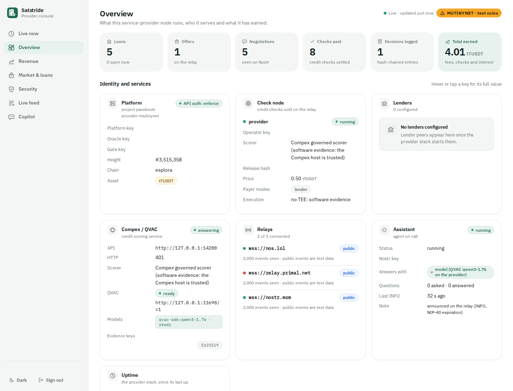
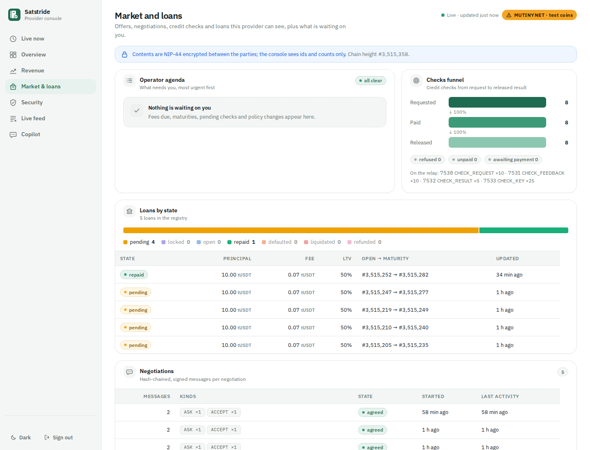
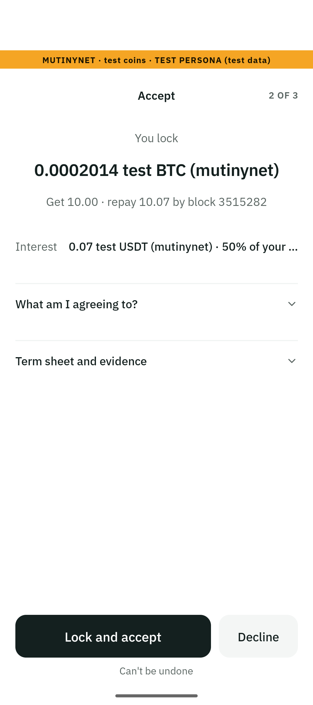
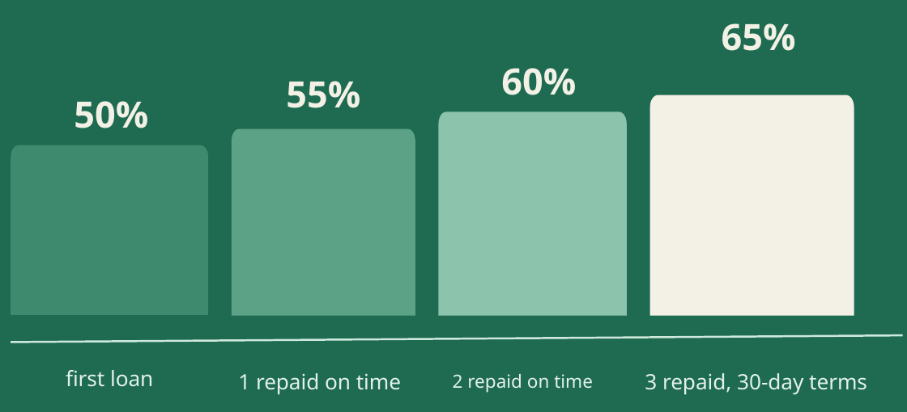

# PassBook · Team Satstride

### Local financial intelligence. Bitcoin in your hands.

**Satstride is the team name; PassBook is the application.** PassBook brings private financial analysis, self-custodial Bitcoin payments and policy-controlled agents into one product. Its first working application is a Bitcoin-backed credit marketplace: borrowers and lenders negotiate directly, approve the same terms, settle test USDT over RGB and carry a verifiable repayment history into the next loan.

The Android wallet keeps its keys and signs on the phone. Local QVAC models investigate financial evidence through constrained tools. Deterministic code checks the findings, prices the agreement and enforces the authority to act. A service provider can run the marketplace, a governed credit-check node and an operator console without holding the phone's keys.

**Built with Tether WDK, RGB, Bitcoin, Nostr and QVAC.**

<p align="center">
   &nbsp;&nbsp;&nbsp;
   &nbsp;&nbsp;&nbsp;
  
</p>

**Team Satstride:** Amir mohammad farhang ([AmirMFarhang](https://github.com/AmirMFarhang)) and [engineer.pulvirenti@gmail.com](mailto:engineer.pulvirenti@gmail.com). **Open-source software under [Apache-2.0](LICENSE)**; third-party code, fonts and datasets retain their own terms in [NOTICE](NOTICE).

[Download PassBook](https://github.com/AmirMFarhang/Satstride/releases/tag/v0.9.11) · [Clone and build](#clone-and-check-the-source) · [Host a local provider](#host-a-local-test-provider) · [Host a governed provider](#host-a-governed-provider)

> Demo assets are test BTC and independently issued test USDT on regtest or Mutinynet. Governed Compex runs use signed software evidence, with an explicitly trusted execution host.

## Experience

The product has three connected surfaces:

| Surface | What you can do | Source |
|---|---|---|
| Android wallet | Hold Bitcoin and RGB assets, borrow or lend, review negotiated terms, approve actions with the phone's lock, and inspect repayment history | [Mobile app](apps/mobile) |
| Provider console | Follow live workflow observations, service health, offers, loans, revenue, decisions and relay activity; inspect policy and the kill switch | [Operator console](apps/console) |
| Local demonstration | Walk through private income analysis, borrowing, repayment, collateral release and a history-based next loan | [Interactive dashboard](web), [demo driver](src/cli/demo.ts) |

Screenshots are included in the repository's curated media assets. The signed Android demonstration package is built locally from source and kept outside the Git repository. The current demonstration build is Android ARM64, version **0.9.11**. [Artifact checksums and provenance](release/artifacts.json) identify the exact build and capture versions.



*Real provider data after the completed demonstration: one repaid loan, eight paid checks and 4.01 test USDT in earned fees. Identifiers are hidden; observed statuses are unchanged.*



<p></p>

*Real device capture, app 0.9.9: verified terms for a seeded Mutinynet test persona, before collateral-lock approval.*

The [verified on-time example](release/on-time-native-example.json) completed a real native RGB loan lifecycle on isolated Bitcoin regtest: repayment confirmed at block **423**, ahead of maturity **448**, followed by collateral release and the platform fee. The receipt names the exact SDK/worklet test and native settlement records. The app and operator console have also been exercised together on physical Android devices over Mutinynet.

## From evidence to an approved action

1. **Discover.** Borrowers find signed lender offers and credit-check providers over Nostr.
2. **Negotiate.** Each side applies its own signed policy. The agreed principal, rate, term and collateral ratio are derived by the negotiation engine and bound into a term sheet.
3. **Authorize the check.** The borrower reviews the requested scope and approves a specific governed execution contract. The check service receives the permitted evidence through constrained tools.
4. **Verify.** The lender independently verifies the released check, the approved workload and its binding to this loan. The model's proposed findings must pass deterministic grounding and policy checks.
5. **Approve and settle.** The phone verifies the signed negotiation and terms, then asks its owner to approve the transaction. Bitcoin collateral and RGB asset transfers follow the selected settlement protocol.
6. **Build reputation.** Repayment and collateral-release evidence becomes a portable repayment-history page that another lender can verify.

The intelligence layer can recommend; signing authority stays in explicit policies and owner approvals. A rejected or incomplete investigation cannot quietly become a successful credit check.

## What the implementation delivers

**A wallet that belongs to its owner.** Tether WDK runs in a separate Bare worklet on Android. The app derives and retains the wallet keys on the device, uses native RGB validation and signs the Bitcoin transactions locally. Borrower and lender roles share the same wallet foundation.

**Private, grounded financial analysis.** The investigator uses evidence identifiers, narrow tools, bounded retries and a deterministic confirmer. It reasons over income, recurring outflows, concentration and payment patterns; pricing and transaction inputs are computed by code. Public lender outputs carry approved checks, bands and commitments.

**A marketplace for useful intelligence.** Check nodes advertise their operator, workload release, execution mode, price and accepted payment arrangements. Selection applies the lender's policy and price ceiling. The protocol supports sealed results, payment-linked key delivery, lender-paid checks and billing at loan close. RGB receipts and per-operator vouchers give the service an asset-native distribution model.

**Governance at the signing boundary.** Signed, versioned policies, quorum, a delay for policy loosening, transaction-bound approval tokens, session limits, a kill switch and a hash-chained decision log connect intent to execution. `npm run satstride -- why <action-id>` explains a recorded decision from its evidence.

**Peer communication with portable verification.** Nostr discovery, NIP-44 encrypted messages, signed negotiation transcripts and the platform API over Nostr connect independently keyed participants. The portable history verifier checks the collateral script and actual Bitcoin spending evidence alongside signed loan records.

**Helpful agents with visible provenance.** QVAC inference in this release runs locally on the provider computer. The app's Ask button sends an encrypted question to that provider over Nostr; each reply identifies whether the model or a labelled help-text fallback answered. The provider console also has a local AI copilot. [Live model smoke checks](release/live-assistant-smoke.json) confirm QVAC answers through both paths. Help can suggest navigation; it cannot approve a financial action. Signed negotiation messages appear at a readable pace and wait for Continue before the credit-check consent step.

**An operator's view of the system.** The console presents workflow observations from the provider's signed APIs, with freshness and explicit service status. Its boot helper checks the target provider and reuses an existing matching frontend, making the live demo easy to open.



*The implemented repayment-history ladder: 50% → 55% → 60% → 65% LTV after verified on-time repayments, with the 65% tier limited to the configured short-term product. This isolated chart and the technology logos are selected pitch assets; full slides are excluded.*

## Read the code

| Question | Start here | Relevant checks |
|---|---|---|
| Where are phone keys and signatures handled? | [Worklet](apps/mobile/worklet), [mobile agent](apps/mobile/src/agent/borrower.ts) | [Mobile tests](apps/mobile/__tests__) |
| How are terms negotiated and committed? | [Negotiation engine](src/market/negotiate-engine.ts), [Nostr transport](src/market/negotiate-nostr.ts), [term sheet](src/market/termsheet.ts) | [Negotiation tests](test/negotiate.test.ts), [term-sheet evidence](test/termsheet-evidence.test.ts) |
| What constrains AI decisions? | [Investigator](src/sandbox/investigate.ts), [grounding](src/sandbox/grounding.ts), [QVAC reasoner](src/ai/qvac-sdk-reasoner.ts) | [Grounding tests](test/grounding.test.ts), [signed-run tests](test/run-record.test.ts) |
| What verifies a governed check? | [Compex envelope verifier](src/scorer/compex-envelope.ts), [loan binding](src/scorer/bundle-terms.ts), [consent](src/scorer/consent.ts) | [Scorer tests](test), [scoring contract](contracts/scoring.contract.json) |
| How does an intelligence provider get paid? | [Check-node protocol](src/checknode), [lender check](src/agents/lender-check.ts) | [Bill binding](test/termsheet-check-bill.test.ts), [check-node tests](test) |
| What authorizes a financial action? | [Governance gate](src/governance/gate.ts), [policy](src/governance/policy.ts), [escrow](src/escrow/escrow.ts) | [Governance and regtest suites](test) |
| How is repayment history portable? | [Repayment-history verifier](src/registry/passbook-doc.ts), [reputation ladder](src/registry/ladder.ts), [RGB notes](src/market/iou.ts) | [Regtest integration tests](test/regtest) |
| What is live in the demo? | [Console workflow projection](apps/console/js/live-model.js), [console API](src/server/console.ts), [boot helper](apps/console/start.mjs) | [Live console tests](test/console-live.test.ts), [boot tests](test/console-demo-start.test.ts) |
| Where is the next protocol work? | [Protocol research source](experiments), [source manifest](experiments/manifest.json) | Native RGB joint settlement, portable wallet histories, check-payment protocols and oracle research |

Root packages use Node **22.13–24**, TypeScript, `bitcoinjs-lib`, `nostr-tools`, WDK and UTEXO RGB modules. The Android app uses Expo SDK 55, React Native 0.83 and a Bare worklet. Dependencies and native inputs are pinned in the lockfiles and fetch scripts. The console uses native browser modules and locally served fonts.

The protocol research packages retain their original source structure for review. They are excluded from the normal build and do not activate a settlement rail; their [manifest](experiments/manifest.json) identifies each source revision and purpose.

## RGB, local AI and WDK in the product

| Technology | Actual use |
|---|---|
| **RGB** | Issue and validate the test asset; receive, disburse and repay through native RGB wallets; issue/transfer/return PBIOU notes; create receipt UDA and per-operator NIA vouchers. The separate RGB Lightning path bridges the same asset into a real channel and uses the returned payment preimage for Bitcoin collateral release. [Wallet](src/rgb/wallet.ts), [Lightning](src/rgb/lightning.ts), [notes](src/market/iou.ts), [receipts](src/checknode/receipt.ts). |
| **QVAC / local AI** | Run the Qwen3 investigator through the local SDK, or the provider's local QVAC endpoint in a governed Compex run. Tool use and grounded findings distinguish irregular but genuine income from prefunding patterns that fixed checks can misread. The model receives constrained evidence and returns coded proposals; code validates their monetary consequences. [Investigator](src/sandbox/investigate.ts), [local reasoner](src/ai/qvac-sdk-reasoner.ts). |
| **Tether WDK** | Generate per-owner wallet material and run Bitcoin/RGB wallet logic inside the Android Bare worklet; keep signing on the phone. [Worklet configuration](apps/mobile/wdk.config.js), [wallet module](apps/mobile/worklet), [party wallets](src/wallet/party.ts). |

## Demo configuration

| Element | How the demonstration runs |
|---|---|
| Assets and people | Real Bitcoin test networks and native RGB transfers; the USDT ticker is our own test asset. Employer/client wallets and income histories are seeded demonstration personas. |
| Time and price | Regtest blocks are mined for the scenario; demo terms map 30 blocks to a month. The showcase uses a labelled price override; the oracle module also implements a signed multi-source live median. |
| Intelligence | QVAC inference runs on the provider computer; Android connects to it over encrypted Nostr. The fixed checks, deterministic playbook and model are separate selectable modes; optional fallbacks are labelled. Fixture benchmarks use synthetic signed records and test chain adapters. |
| Governed execution | The demonstrated Compex provider runs a pinned Credit Desk container with local QVAC and signed software evidence. The execution host and evidence signer are trusted in this mode. |
| Identity and policy | The demo uses configured provider public keys, test identities and explicit policy presets; public demo keys and fixture signatures are test material. Phone signing and owner approvals use the actual device wallet. |
| Operational views | The console reads the provider's signed APIs. Workflow progress is derived from observed records and timestamps; screenshots identify their capture version and whether they use live data or fixtures. |

## Original work and third-party foundations

PassBook is Team Satstride's original hackathon project: the wallet experience, Bitcoin-backed credit workflow, grounded financial investigator, portable repayment history, policy-controlled agents, provider marketplace and operator console form one integrated entry. The team developed and tested these components together, including the mobile application and the public-relay demonstration.

[Compex](https://getcompex.com/) is an existing third-party platform used for governed intelligence execution. The entry adds its credit-check workload and the integration that binds approved runs and verified outputs to negotiated loans. RGB, Tether WDK, QVAC, Bitcoin, Nostr, Expo and React Native are external foundations, with their own licenses and contributors acknowledged in [NOTICE](NOTICE).

**Why the public commit history is short.** We developed PassBook privately during the hackathon. After seeing competitors consult and copy public repositories, we chose to publish the implementation in the final hour to protect our work. We checked this publication timing with organizers and mentors, who confirmed it was acceptable in those conversations. This is the team's account of those conversations; the compact public history reflects that release decision. The implementation is published as original source files on `main`.

| Review area | Concrete entry point |
|---|---|
| RGB | [Native wallets](src/rgb), [phone RGB worklet](apps/mobile/worklet), [chain integration tests](test/regtest) |
| QVAC | [Tool-using investigator](src/sandbox/investigate.ts), [grounding checks](src/sandbox/grounding.ts), [local QVAC backend](src/ai/qvac-sdk-reasoner.ts) |
| Execution | [Escrow and settlement](src/escrow), [agents](src/agents), [integration suites](test/regtest), [artifact manifest](release/artifacts.json) |
| UX/UI | [Phone screens](apps/mobile/src/ui), [operator console](apps/console), [dashboard](web) |
| Innovation | [Portable repayment proofs](src/registry/passbook-doc.ts), [paid intelligence protocol](src/checknode), [policy gate](src/governance/gate.ts) |
| Marketability | The borrower/lender/provider model, implemented [economics](src/core/economics.ts), and the pilot roadmap below |
| WDK | [Bare worklet configuration](apps/mobile/wdk.config.js), [phone wallet module](apps/mobile/worklet), [WDK party accounts](src/wallet/party.ts) |

## Run and build

### Install the published Android app

1. Download [PassBook Android 0.9.11](https://github.com/AmirMFarhang/Satstride/releases/tag/v0.9.11), including the APK and `SHA256SUMS`. Use an ARM64 Android device with API 29 or newer.
2. Open the APK on the device and allow installation from your chosen download source. Existing signed demo installations upgrade in place; keep their app data.
3. Create a test wallet and keep its recovery material private. Use your phone lock when an action requests owner approval.
4. Scan a provider's QR/link, or open **Wallet → Settings → Network** and enter its network, platform public key and relays. Save, fully close the app, then reopen it to apply the connection.
5. Use Mutinynet test BTC and the provider's test RGB asset, or connect to a local regtest provider. The app shows its network and test-coin labels throughout the flow.

The source build and provider options below let you run the same application with your own keys and infrastructure. The published demo APK pins the demonstration help provider; set `EXPO_PUBLIC_PASSBOOK_ASSISTANT_PK` to your own help provider's public key before building for your deployment.

### Clone and check the source

Use Node 22.13 or newer within the supported range in `package.json`, plus npm and Git:

```sh
git clone https://github.com/AmirMFarhang/Satstride.git
cd Satstride
npm ci
npm run check
```

The prepared source snapshot passes the root typecheck and **825 unit tests**, with five explicit skips, plus the mobile checks and **161 mobile tests**. [Verification details](release/verification.json).

The suite covers the negotiation protocol, evidence binding, privacy controls, deterministic economics, governance and API authentication. Chain integration uses an isolated Bitcoin/RGB stack:

```sh
npm run test:regtest
```

The integration suites expect matching local regtest services; the real Lightning scenarios also require configured RGB Lightning nodes. [Compose definitions](infra/compose.yaml) and [Lightning tooling](infra) provide the infrastructure entry points.

### Host a local test provider

Use a Linux host with Node 22, Docker Engine and Compose v2, Bash, Python 3 and curl. Install Android platform-tools for a phone connected by USB. From the clone prepared above:

```sh
(cd apps/mobile && npm ci && npm run setup)

# Download/check the local model before starting the demo.
export PASSBOOK_AI=qvac QVAC_MODEL=qwen3-1.7b QVAC_CTX_SIZE=4096
npm run qvac:probe

# Create local test wallets and start Bitcoin, Electrum, RGB transport,
# Nostr, the platform, a test lender and the demo miner.
apps/mobile/infra/provider.sh demo

# Forward the local services to one authorized USB device.
# With multiple devices, first set ANDROID_SERIAL to the intended device.
apps/mobile/infra/regtest.sh reverse
./infra/demo-console.sh --platform http://127.0.0.1:4301 --port 4381
```

The provider prints a private operator link. Open `http://127.0.0.1:4381/` and use that link for the console. On the phone, select **Regtest (laptop, USB)** in **Wallet → Settings → Network**, save and reopen the app. Keep USB connected for this profile.

| Local service | Default endpoint |
|---|---|
| Bitcoin RPC | `127.0.0.1:18603` |
| Electrum | `127.0.0.1:50171` |
| RGB proxy | `rpc://127.0.0.1:3260/json-rpc` |
| Nostr | `ws://127.0.0.1:7937` |
| Platform | `http://127.0.0.1:4301` |

Choose unused ports/project settings on a shared host. The local provider uses its local credit-check path; the governed Compex provider is configured separately below.

To receive test balances, copy the phone's **regtest** Bitcoin receive address. Then prepare asset reception on the phone, create its test-USDT receive invoice and pay that invoice from the provider's seeded payer:

```sh
apps/mobile/infra/regtest.sh fund 'YOUR_PHONE_BCRT1_ADDRESS' 0.05
apps/mobile/infra/provider.sh salary 'YOUR_PHONE_RGB_INVOICE' 250
```

Keep the phone open to receive the RGB transfer. The provider owns the generated test payer; the phone retains its own wallet keys. To stop this environment while retaining wallets, state and volumes:

```sh
apps/mobile/infra/provider.sh stop
apps/mobile/infra/regtest.sh stop
```

### Host a governed provider

Provision your Compex operator installation using the [Compex documentation](https://docs.getcompex.com/). The integration helper expects an executable stack adapter supporting `up`, `token`, `status` and `down`; its private runtime directory contains the generated `api.json` and token-file reference. Supply the verifier `compex-verify.cjs`, the independently verified **public** evidence-key set `compex-evidence-keys.json`, and an approved Credit Desk image already available locally at its pinned digest.

```sh
export PASSBOOK_SP_COMPEX_STACK='/absolute/path/to/compex-stack.sh'
export PASSBOOK_SP_COMPEX_DIR='/absolute/path/to/compex-installation'
export PASSBOOK_SP_COMPEX_STATE='/absolute/path/to/private/compex-runtime'
export PASSBOOK_SP_COMPEX_FILES='/absolute/path/to/verifier-and-public-keys'
export PASSBOOK_SP_COMPEX_IMAGE='YOUR_APPROVED_IMAGE@sha256:YOUR_VERIFIED_DIGEST'

export PASSBOOK_SP_NETWORK=regtest PASSBOOK_SP_PROJECT=satstride-provider
export PASSBOOK_SP_STATE="$PWD/data/service-provider/satstride-provider"
./infra/service-provider.sh up
./infra/service-provider.sh status
./infra/demo-console.sh --platform http://127.0.0.1:4351 --port 4381
```

The helper reuses the Compex installation's QVAC endpoint, default `http://127.0.0.1:11690/v1`, and API port `14200`. Keep tokens, operator links and generated `data/` private. Its setup generates and preserves provider keys and publishes connection details in `provider.json`.

For **your own governed deployment**, verify its Compex evidence keys independently, then pin those public keys before building the phone app:

```sh
# From the repository root, with PASSBOOK_SP_STATE still set above:
apps/mobile/infra/provider.sh service keys
(cd apps/mobile && npm run apk)
```

The import helper copies public verification fields from your provider information into the app's evidence-key file. Use the resulting build with that provider; the downloadable demo APK carries the demonstration signer's pins. The basic local provider uses its own local check path.

For a provider reached over public Nostr on **Mutinynet**, provision your authorized RGB test asset and its state file, retain the Compex configuration above, then use a separate project/state directory:

```sh
export PASSBOOK_SP_NETWORK=mutinynet
export PASSBOOK_SP_PROJECT=satstride-provider-mutinynet
export PASSBOOK_SP_STATE="$PWD/data/service-provider/satstride-provider-mutinynet"
export PASSBOOK_SP_MUTINYNET_STATE='/absolute/path/to/mutinynet-asset-state.json'
export PASSBOOK_SP_PUBLIC_RELAYS=default PASSBOOK_SP_LENDERS=none
./infra/service-provider.sh up
./infra/service-provider.sh status --json
./infra/demo-console.sh --platform http://127.0.0.1:4391 --port 4381
```

The asset state identifies the Mutinynet network and your test asset's ID, ticker and name. Fund your test wallets on that network. Scan the generated provider QR/link, verify its platform key, save the phone's settings and reopen it. This profile connects over public Nostr, with the configured HTTP address as a fallback; the borrower and lender can both use phones. Keep chain-observer evidence current for each governed investigation.

### Open an existing provider's console

```sh
./infra/demo-console.sh --platform http://127.0.0.1:4391 --port 4381
```

Open `http://127.0.0.1:4381/` and supply the provider's private operator link in the browser. The helper starts only the frontend and preserves the provider's running services and state. Set `--platform` to the address of your provider.

### Start the local showcase

With Docker available, the showcase command manages the demo stack and its persistent session:

```sh
npm run showcase
```

The UI displays the network, test assets, model mode and the next approval gate. Its state, wallets and private evidence stay in ignored local directories. The [showcase supervisor](src/cli/showcase.ts) serves the session controls and preserves prior runs.

### Build the Android app

Use Node 22, JDK 17 and the Android SDK:

```sh
cd apps/mobile
npm ci
npm run setup
npm run check
npm run keystore
npm run apk
```

The ARM64 build is written to the mobile app's ignored `dist/` directory; the packaged demonstration artifact is named `passbook-wallet-<version>-arm64.apk`. Each developer generates their own signing keystore. Keep that same key for later upgrades; a build signed with a different key should use a separate test device or application identifier. Wallet data, release keys and device captures stay outside source control. Network and provider settings are explicit app/build configuration.

## Compex: governed intelligence as an add-on

[Compex](https://getcompex.com/) adds an execution contract, approved scope, workload identity, model policy and verifiable run evidence around the financial investigation. The PassBook integration connects this governed execution to a real negotiated loan: the borrower approves the run, the Credit Desk workload returns constrained outputs, and the lender checks those outputs independently before accepting them.

The add-on foundation includes:

- **Credit Desk:** grounded investigation through contract-scoped tools and local QVAC inference.
- **Verifiable releases:** approved image and model measurements, signed envelopes, consent and scored-loan binding.
- **Provider economics:** priced checks, per-operator offers, close-time billing, RGB receipts and vouchers.
- **Operational governance:** policy decisions, evidence export, independent verification and a visible operator console.

Explore the [Compex website](https://getcompex.com/), [documentation](https://docs.getcompex.com/) and [interactive sandbox](https://app.getcompex.com/try).

Hardware-backed execution is part of the roadmap below. The broader crypto ecosystem already uses TEEs for related work: [Phala's ERC-8004 agent](https://github.com/Phala-Network/erc-8004-tee-agent) combines agent identity with Intel TDX attestation, while [iExec](https://docs.iex.ec/get-started/welcome) provides confidential computing and permissioned data access for decentralized applications. These are technical reference points for independently verifiable execution.

## Business model and direction

The initial customer is a Bitcoin holder who wants liquidity while retaining direct control of their wallet. The lender side serves peers and professional operators who need explicit risk policies, independently checkable information and a clear operating view. Intelligence providers add a third participant: they compete to deliver a useful, verifiable service.

The implemented loan economics charge the borrower principal plus agreed term interest. A configured platform share is paid by the lender after close; the current policy is **15% of term interest**. Credit-check providers price their own work. These mechanisms support a business built around successful lending and useful intelligence, with an open protocol and replaceable operators. [Economics implementation](src/core/economics.ts), [fee enforcement](src/server), [check marketplace](src/checknode).

The next commercial step is a focused pilot with Bitcoin communities, specialist lenders and wallet partners: test repeat borrowing, lender operations, conversion through the approval flow and the value of better financial evidence. Pilot results will shape pricing, support and distribution before expansion.

## Roadmap

These are planned delivery targets, with each phase gated by its own review and acceptance. Credit scoring becomes an optional service within a broader lending policy, and lending becomes one application of a wider, governed intelligence network.

| Milestone | Product and engineering work | Customer and business outcome |
|---|---|---|
| **Pilot-ready experience** | Unify the PassBook app, console and public product website under Team Satstride’s product identity; simplify wallet setup and provider connection; make consent, negotiation, progress and recovery states clear; publish reproducible app packages and guided demo scripts | A first-time borrower and lender can understand the product, complete a guided test and return for a second transaction |
| **On-device QVAC runtime** | Add optional mobile inference in a separate runtime that never receives wallet keys; offer compact quantized models with verified downloads, device-capacity checks, bounded context, cancellation and resource budgets; validate stability, memory use, temperature and response time on supported phones | Private help and selected intelligence can run without a provider connection after setup; users retain a clear choice of phone or provider inference |
| **Peer-to-peer by default** | Advance the native RGB/Bitcoin settlement work through adversarial validation; make origination, negotiation and proof exchange portable across independent devices; improve multi-relay recovery and self-hosted provider boot | Borrowers and lenders choose their counterparties and operators, with deployment options that fit communities and wallet partners |
| **Optional scoring and flexible lending** | Make credit scoring an explicit choice in the agreed lending policy; support collateral-led lending without a score, direct peer agreements and optional paid checks selected by the lender and borrower; preserve signed terms and owner approval | Lenders choose the evidence they need, and borrowers can access products with a suitable balance of privacy, cost and underwriting |
| **Intelligence service marketplace** | Expand contract-scoped services from credit into cash-flow forecasting, invoice and counterparty review, fraud-pattern alerts, treasury monitoring, recurring-payment analysis and small-business working-capital decisions; compare providers by quality, price and execution policy | Useful private intelligence serves individuals, businesses, wallet partners and autonomous agents across real financial workflows |
| **Governance and execution assurance** | Extend policy templates, approval review, delegated sessions and incident controls; add hardware-attested Compex execution and measured-release verification; exercise key rotation, revocation and independent verification | Lenders and service operators can review exactly who authorized an action, what ran and which evidence supports it |
| **Partner pilots and expansion** | Launch a small, measured borrowing/lending pilot; add portfolio and repayment monitoring; refine accessibility, localization and mobile performance; publish integration examples for wallets and intelligence providers | Validate repeat use, service quality and a sustainable operator business before widening distribution |

**Why mobile inference is on the roadmap.** The team reports that the available test device struggled with the mobile runtime and crashed during its attempts. The shipped demonstration therefore keeps QVAC on the provider computer. The next mobile phase targets a stable, optional [QVAC runtime](https://docs.qvac.tether.io/sdk/js-ts-sdk/) with smaller models and explicit device checks before enabling on-device inference.

Beyond the pilot, Team Satstride aims to develop PassBook into a financial intelligence network for people and autonomous agents: a shared foundation for private analysis, explicit spending authority, paid collaboration and verified outcomes. Bitcoin-backed credit is the first application of that foundation.

## Source and attribution

This repository contains PassBook's original source, published by Team Satstride. The maintained product description is this README; source, tests, configuration and curated release artifacts form the review entry points. Historical session notes and machine-specific handoff files are excluded. Future maintained documentation can be added through explicit `.gitignore` exceptions.

[NOTICE](NOTICE) records the project contributors and third-party design references, including Compex Fraud Desk, Tazama and AMLSim, and preserves the separate terms for vendored code, fonts and datasets. Third-party projects and Compex remain under their own terms.
